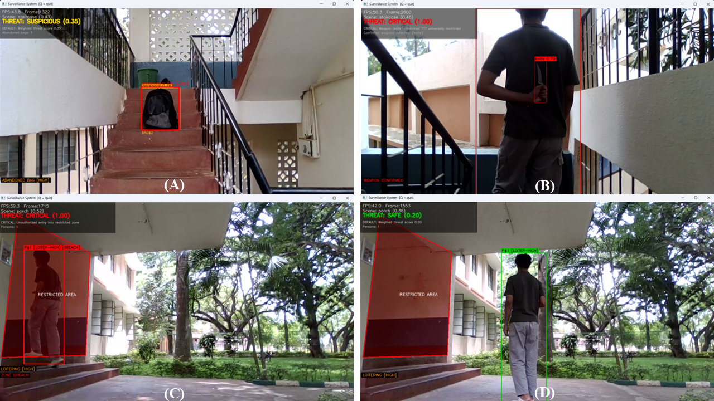

# AI-Based Real-Time Intelligent Surveillance System

An AI-powered real-time surveillance system designed to identify potential security threats through object detection, object tracking, behavioural analysis, scene classification and context-aware threat assessment.

The system analyses live webcam feeds, video files and RTSP streams to identify suspicious activities and generate alerts based on multiple conditions.

## Key Features

- **Person and Bag Detection:** Detects people and bags using YOLOv8.
- **Weapon Detection:** Identifies potential weapons using a custom-trained YOLO11 model.
- **Object Tracking:** Tracks detected people and bags using the SORT tracking algorithm.
- **Behavioural Analysis:** Identifies suspicious activities such as loitering, crowd formation, fast movement and abandoned bags.
- **Scene Classification:** Uses ResNet18 with Places365 to understand the surrounding environment.
- **Geofencing:** Identifies people entering configured restricted zones.
- **Context-Aware Threat Assessment:** Evaluates multiple detection and behavioural conditions to determine threat levels.
- **Real-Time Alerts:** Generates alarm and voice notifications and sends email alerts with supporting screenshots.
- **Visual Monitoring:** Displays detection results, tracking information, trajectories, FPS and threat levels through an on-screen HUD.

## System Architecture

The system consists of nine integrated modules:

| Module | Description |
|---|---|
| M1 + M2 – VideoSource | Captures video from webcams, video files or RTSP streams using threaded frame acquisition. |
| M3 – ObjectDetector | Performs person, bag and weapon detection using YOLO models. |
| M4 – ObjectTracker | Tracks detected people and bags using SORT. |
| M5 – BehaviourAnalyser | Analyses movement patterns, loitering, crowd formation, abandoned bags and geofence breaches. |
| M6 – SceneClassifier | Classifies the environment using ResNet18 and Places365. |
| M7 – ThreatAnalyser | Evaluates detection results and behavioural indicators to calculate threat levels. |
| M8 – AlertManager | Manages audio, voice and email alerts with cooldown mechanisms. |
| M9 – Display | Displays detection overlays, trajectories, geofence zones and threat information. |
| Main Orchestration | Coordinates the modules and executes the real-time surveillance loop. |

## Threat Assessment Levels

The system categorises detected situations into four levels:

- **SAFE:** No significant threat indicators detected.
- **SUSPICIOUS:** Potentially suspicious activity identified.
- **HIGH:** Elevated threat conditions requiring attention.
- **CRITICAL:** Multiple or serious threat indicators detected.

Threat assessment considers factors such as weapon detection, loitering, abandoned bags, crowd formation, fast movement, geofence breaches and scene context.

## Technologies Used

| Category | Technologies |
|---|---|
| Programming Language | Python |
| Object Detection | YOLOv8, YOLO11 |
| Object Tracking | SORT |
| Scene Classification | ResNet18, Places365 |
| Deep Learning | PyTorch, Torchvision |
| Computer Vision | OpenCV |
| Numerical Processing | NumPy |
| Tracking Dependencies | FilterPy, LAP, SciPy |
| Audio Alerts | Pygame, pyttsx3 |
| Email Notifications | SMTP |
| Configuration | Python-dotenv |

## Project Structure

```text
surveillance_system/
│
├── alerts/                         # Generated alert screenshots
├── final_dataset/                  # Training dataset
├── new_model_result/               # Model training results
│
├── .env                            # Email configuration and credentials
├── .gitignore
│
├── alarm.wav                       # Alarm sound
├── siren.wav                       # Siren sound
│
├── categories_places365.txt        # Places365 scene labels
├── config.py                       # Central configuration and thresholds
├── download_places365.py           # Places365 model download script
├── draw_geofence.py                # Geofence drawing utility
├── main.py                         # Main application
├── sendmail.py                     # Email alert functionality
├── sort.py                         # SORT tracking implementation
│
├── requirements.txt                # Python dependencies
├── README.md
│
├── resnet18_places365.pth.tar      # Places365 model weights
├── weapon_yolo11s.pt               # Custom weapon detection model
├── weapon_yolo11s(old).pt          # Previous weapon model
└── yolov8n.pt                      # Person and bag detection model
```

## Installation and Setup

### 1. Clone the Repository

```bash
git clone <your-repository-url>
cd surveillance_system
```

### 2. Create a Virtual Environment

```bash
python -m venv venv
```

Activate it on Windows:

```bash
venv\Scripts\activate
```

### 3. Install Dependencies

```bash
pip install -r requirements.txt
```

Install `python-dotenv`, which is used to load environment variables:

```bash
pip install python-dotenv
```

For CPU-only PyTorch installation, if PyTorch is not already installed:

```bash
pip install torch torchvision --index-url https://download.pytorch.org/whl/cpu
```

### 4. Model Files

The project includes the following model files:

- `yolov8n.pt`
- `weapon_yolo11s.pt`
- `weapon_yolo11s(old).pt`
- `resnet18_places365.pth.tar`

The model files should remain in the project root directory so that the configured paths resolve correctly.

### 5. Configure Environment Variables

Create a `.env` file in the project directory:

```env
SMTP_HOST=smtp.gmail.com
SMTP_PORT=587
SMTP_USER=your_email@gmail.com
SMTP_PASSWORD=your_app_password
ALERT_RECIPIENT=recipient@gmail.com
```

Use an appropriate email app password where required. Do not upload your actual `.env` file or credentials to GitHub.

### 6. Run the Application

```bash
python main.py
```

Press **Q** to exit the surveillance window.

## Configuration

The `config.py` file contains the central configuration settings, including:

- Video source selection.
- Frame dimensions and detection intervals.
- Object detection confidence thresholds.
- Behavioural analysis thresholds.
- Weapon confirmation settings.
- Geofence zone configuration.
- Threat assessment thresholds.
- Alert cooldown settings.

The default video source is webcam (`0`). It can also be configured to use a video file or RTSP stream.

Geofence zones can be configured through the `GEOFENCE_ZONES` setting.

## Alert Mechanism

When the system identifies conditions that meet configured threat thresholds, it can:

1. Display the detected threat on the surveillance interface.
2. Trigger an alarm or voice notification.
3. Capture a screenshot of the detected situation.
4. Send an email notification with alert information and an optional screenshot attachment.

Email notifications require valid SMTP configuration in the `.env` file.

## 📸 Project Output

The following screenshot demonstrates the system's real-time detection, tracking, and context-aware threat assessment capabilities.



## Future Enhancements

- Improve detection accuracy with additional training data.
- Optimise inference performance for different hardware configurations.
- Extend behavioural analysis with additional activity patterns.
- Develop a web-based monitoring dashboard.
- Introduce historical event storage and alert analytics.

## Disclaimer

This project is developed for academic and research purposes. Detection results are model predictions and should not be treated as definitive confirmation of a security threat. Human verification is recommended before taking any action.

## Third-Party Acknowledgements

This project uses the SORT (Simple Online and Realtime Tracking) algorithm.

- Original Author: Alex Bewley
- License: GNU General Public License v3.0 or later (GPL-3.0-or-later)

The original copyright and licensing notices are retained in `sort.py`.

## Author

**Starlin Pereira**

GitHub: https://github.com/Starlin7
LinkedIn: https://www.linkedin.com/in/starlinpereira